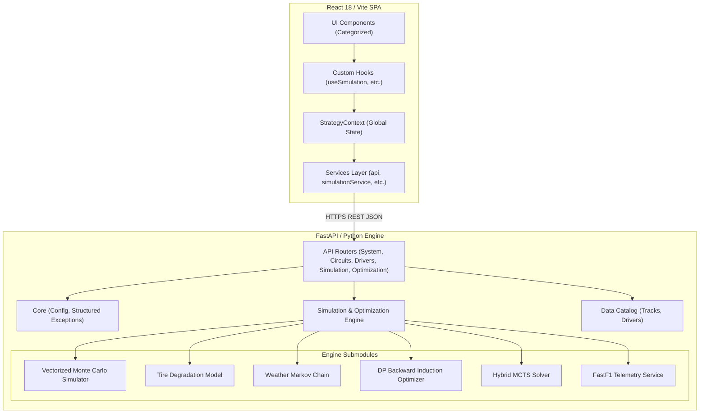

# 🏎️ Apex Strategy Simulator — System Architecture & Design

This document details the modular system architecture, domain boundaries, data flow pipelines, and design patterns across the F1 Monte Carlo Race Strategy Simulator.

---

## 1. High-Level System Architecture



---

## 2. Directory Layout & Separation of Concerns

### Backend Architecture (`backend/app/`)

```
backend/
├── app/
│   ├── api/
│   │   ├── dependencies.py          # Track & driver parameter resolvers
│   │   └── routes/
│   │       ├── circuits.py          # /tracks endpoints
│   │       ├── drivers.py           # /drivers endpoints
│   │       ├── optimization.py      # /optimize and /optimize-mcts endpoints
│   │       ├── simulation.py        # /simulate, /compare, /undercut-analysis
│   │       ├── system.py            # /, /health
│   │       └── telemetry.py         # /fastf1/calibrate
│   ├── core/
│   │   ├── config.py                # Centralized environment settings
│   │   └── exceptions.py            # Typed domain exceptions & global handlers
│   ├── data/
│   │   ├── drivers.py               # Calibrated 2023 driver profiles
│   │   └── tracks.py                # Circuit presets & track characteristics
│   ├── engine/
│   │   ├── mcts/
│   │   │   ├── solver.py            # MCTSSolver, UCB1, adaptive refinement
│   │   │   └── state.py             # MCTSState, action transitions, rewards
│   │   ├── calibration_harness.py   # Heuristic vs ground-truth calibration
│   │   ├── dp_optimizer.py          # Dynamic Programming backward induction
│   │   ├── fastf1_service.py        # FastF1 telemetry loader & offline cache
│   │   ├── heuristic_evaluator.py   # Decomposed interpretable leaf costs
│   │   ├── simulator.py             # NumPy-vectorized Monte Carlo engine
│   │   ├── tire_model.py            # Two-phase quadratic tire degradation
│   │   └── weather.py               # Stochastic Markov weather transitions
│   ├── models/
│   │   ├── mcts.py                  # MCTS request/response schemas
│   │   ├── optimization.py          # DP optimization schemas
│   │   ├── strategy.py              # StrategyInput, SimulationResponse, Compare
│   │   ├── system.py                # Health & root response schemas
│   │   └── undercut.py              # Undercut curve schemas
│   └── main.py                      # FastAPI application factory & lifespan
├── main.py                          # Backward compatibility entrypoint
├── requirements.txt                 # Pinned dependencies with security patches
└── Procfile                         # Cloud process deployment
```

### Frontend Architecture (`frontend/src/`)

```
frontend/src/
├── config/
│   ├── constants.js                 # Strategy defaults, view tabs, compounds
│   └── env.js                       # Environment variable access (API_BASE_URL)
├── context/
│   └── StrategyContext.jsx          # React state management for strategies/results
├── hooks/
│   ├── index.js                     # Central hook exports
│   ├── useOptimizer.js              # DP optimizer hook
│   ├── useSimulation.js             # Monte Carlo simulation hook
│   └── useStrategyContext.js        # Safe context consumer hook
├── services/
│   ├── api.js                       # Centralized HTTP client (timeouts, errors)
│   ├── metadataService.js           # Track presets, drivers, telemetry cache
│   ├── optimizationService.js       # DP and MCTS API endpoints
│   └── simulationService.js         # /simulate, /compare, /undercut-analysis
├── components/
│   ├── common/                      # Shared UI components
│   │   ├── ColdStartOverlay.jsx     # Free-tier server wake-up modal
│   │   ├── DriverSelector.jsx       # Driver picker with teammate metrics
│   │   ├── ErrorBanner.jsx          # Dismissible alert banner
│   │   ├── FastF1Banner.jsx         # Empirical telemetry validation badge
│   │   ├── StatsBanner.jsx          # Percentiles, moments, win rate banner
│   │   └── TrackSelector.jsx        # Circuit preset selector cards
│   ├── strategy/                    # Strategy inputs & optimization
│   │   ├── AlternativesTable.jsx    # Ranked top alternative plans
│   │   ├── OptimizerPanel.jsx       # DP optimizer configuration
│   │   └── StrategyForm.jsx         # Multi-stint strategy input form
│   ├── charts/                      # Data visualizers (Recharts)
│   │   ├── DriverImpactChart.jsx    # Driver pace delta comparison
│   │   ├── MCTSTreeChart.jsx        # Tree candidate branch visualizer
│   │   ├── ResultsChart.jsx         # Lap time distribution histogram
│   │   ├── StintTimeline.jsx        # Visual tire stint timeline bar
│   │   ├── UndercutChart.jsx        # Undercut win rate probability curve
│   │   └── WeatherVarianceChart.jsx # Dry vs mixed weather distribution
│   └── simulator/                   # Real-time replanning
│       ├── MCTSDiagnosticsPanel.jsx # Search iterations & trigger stats
│       └── RaceSimulatorTab.jsx     # Mid-race MCTS replanner dashboard
├── App.jsx                          # Layout coordinator component
└── main.jsx                         # React DOM mount point
```

---

## 3. Key Design Patterns & Engineering Highlights

### Clean Separation of Business Logic
* UI components do **not** initiate raw `fetch()` calls or manage network transport.
* All data mutations, API queries, and network timeout handling reside in `services/`.
* Reactive orchestration is managed in `StrategyContext.jsx` and exposed through clean feature hooks (`useSimulation`, `useOptimizer`).

### Scalable API Structure & Routing
* Domain routes are modularized using FastAPI `APIRouter`.
* Dual-mount routing: All endpoints are accessible at root (`/simulate`, `/tracks`, etc.) for existing client compatibility, and simultaneously mounted under `/api/v1/` for versioned forward evolution.
* Unified error payloads: Custom domain exceptions (`CircuitNotFoundError`, `DriverNotFoundError`, `SimulationExecutionError`) are mapped to structured JSON error responses with HTTP status codes.

### Pydantic v2 Modernization
* Deprecated `.dict()` invocations have been upgraded to `.model_dump()` across all dependencies and models, eliminating deprecation warnings while optimizing serialization performance.

### Resilient Cloud UX (Cold-Start Handling)
* Render's free-tier spin-down is handled gracefully:
  1. On mount, `metadataService.pingHealth()` sends a pre-warming request.
  2. If the backend is waking from sleep, `ColdStartOverlay` displays a non-blocking informational modal.
  3. `apiClient` detects HTTP 502/503/504 gateway cold-start responses and presents friendly guidance.

### Security Compliance
* **CA Certificate Hardening**: Pins `certifi>=2024.7.4` to protect outbound HTTPS calls against compromised intermediate CA certificates (eMudhra advisory).
* **Node.js LTS Hardening**: Enforces Node.js `>=22.23.4` via `.node-version` and `package.json` engines to mitigate Brotli RCE and TLS validation vulnerabilities.
